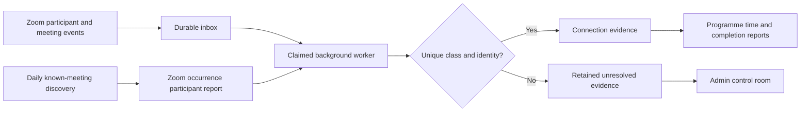

# Zoom attendance: identification, duration and rollout

## What this change implements

Zoom join/leave webhooks are persisted before acknowledgment. A database-backed worker matches the actual recurring meeting occurrence to its class, resolves the participant, records connection intervals and reconciles the final Zoom participant report. The daily discovery pass looks for the last 90 days by default of occurrences of known class meetings, including meetings whose webhooks were missed. Set ZOOM_ATTENDANCE_BACKFILL_DAYS to adjust that window (35?365 days). This is a recovery window, not a guarantee that Zoom can identify historical anonymous guests.



* Each occurrence uses Zoom's meeting UUID, not just a recurring meeting ID. Ambiguous timetable/topic matches retry and surface in the admin queue; the first matching database schedule is not used arbitrarily.
* Reconnect gaps are excluded. Overlapping devices are merged before counting seconds. Open connections are provisional; they do not satisfy an hour requirement.
* A final report can correct earlier connection evidence. Late webhook replay cannot overwrite final report timing. A meeting-ended event does not invent a leave time for everybody.
* Report jobs checkpoint every 20 participants and cache the fetched report. A crashed worker can resume. Claims use a database lease; duplicate deliveries and worker instances cannot intentionally award the same attendance credit twice.
* Live participant events have processing priority over discovery/backfill. After acknowledgment, the webhook attempts one participant event as a latency optimization. The separate worker is required for reliability; web request background tasks alone are insufficient.
* Students, their linked parents, assigned programme teachers and admins have server-authorized report access. Changing a child query parameter does not bypass authorization. Worker access requires `CRON_SECRET`.
* Legacy portal/manual attendance stays separate. Its presence marks and existing points are preserved; clicks do not generate measured class-time evidence. The new one-hour completion calculation reads Zoom intervals, not manual attendance marks.

## Programme requirements

| Enrolled programme | Full-week requirement | Completion rule |
| --- | --- | --- |
| Arabic / Tajweed | 3 one-hour days | 60 actual connected minutes per teaching day; simultaneous Arabic/Tajweed enrolments share this requirement |
| Seerah | 1 one-hour day | 60 actual connected minutes; same-day alternative slots do not count twice |
| Leadership / Life Lessons / Life Skills | 1 one-hour day | 60 actual connected minutes |
| Sunday parental session | 1 one-hour day, separately | Parent identity only; cannot satisfy a child's course requirement |

A full-bundle learner therefore has five child-class requirements per full week. Extra hours on one day cannot replace three distinct Arabic teaching days. A 59-minute connection is below the requested 60-minute target; there is no hidden grace period. Non-enrolled programme requirements are omitted. Existing attendance points still reward recorded presence under the existing policy; they are not retroactively revoked based on the new duration target.

Weeks run Monday–Sunday in Pakistan time, consistently with the existing attendance day policy. The report does not assess calendar-month boundary weeks or a mid-week enrolment against a full-week quota; these are explicitly marked partial. Current weeks show in progress. Below-target time is **not** treated as proof of absence when Zoom evidence may be incomplete. Historical enrolment changes without a recorded end date and cancelled classes need administrative review before using the report as an absence/compliance record.

The monthly portal report includes programme minutes, per-week completed/required days, separate parent-session participation, raw join/leave evidence, month selection, a monthly CSV and a connection-evidence CSV. An open connection panel polls an authorized lightweight status endpoint and refreshes the full report after closure. This release provides portal reports and CSV downloads; it does not automatically email monthly reports or claim to assess learning performance.

## What parents must do

Open **Attendance** after activation and copy the displayed Zoom name:

* Each child has a permanent name beginning `GM-S-…`. Use that complete prefix in Zoom for that child's classes, whether joining from the portal, an email, WhatsApp, or a saved Zoom link. No new child Zoom account is required by this code-based matching system.
* Parents use their own `GM-P-…` name for Sunday parental sessions. Switch back to the child's name for child classes.
* If siblings share a device, the one Zoom connection identifies the displayed child only. Separate devices/connections with distinct child codes are needed for independently verifiable child attendance. A shared parent email alone cannot distinguish siblings.
* Use the assigned code from the beginning of the meeting. An anonymous device name such as “iPhone” cannot reliably be reconstructed later. Exact registered names and unambiguous emails are fallback matches, with their match method visible in the report.
* Attendance codes are identity labels, not passwords or proof of physical identity. They do not prove attention or learning. Do not advertise them as authenticated Zoom accounts. For stronger identity assurance, individually issued Zoom registration links or authenticated Zoom accounts would be an additional integration, not something implemented by this rollout.

## Zoom account requirements

All hosting users must belong to the account accessible to the existing Server-to-Server OAuth integration. A separate unrelated Zoom account is not covered by the existing single-account credentials; move that host into the managed account or design a separate multi-account integration before claiming coverage.

Zoom's participant-history API requires a paid Pro-or-higher account. Confirm each host's licence and account membership. In the Zoom Marketplace app, keep existing meeting/recording scopes and add account-level access to:

* `meeting:read:list_past_participants:admin`
* `meeting:read:list_past_instances:admin`

An existing classic `meeting:read:admin` grant may cover these endpoints. Save and reactivate/reauthorize the app after scope changes, according to its app type. Do not replace functioning recording permissions with these attendance-only scopes.

Subscribe to these events for the managed hosts:

* `meeting.started`
* `meeting.participant_joined`
* `meeting.participant_left`
* `meeting.ended`

Keep `recording.completed` enabled as an additional reconciliation trigger. Use the existing endpoint `https://genmumin.com/api/zoom/webhook` and its matching `ZOOM_WEBHOOK_SECRET_TOKEN`. Webhook signatures must be valid and fresh. Check the app event delivery logs; successful HTTP delivery is not the same as successful identity matching.

Make sure every class is scheduled under the correct programme, host and Zoom meeting ID, and Sunday schedules have the existing `[Category:PARENTAL]` marker. Do not reuse one personal meeting room across unrelated simultaneous classes if Zoom's topic/timing cannot distinguish them. Keep the account setting for one-person meetings in reports enabled if these must be recoverable. Breakout-room, waiting-room and guest-email behavior must be checked in the pilot; this code does not assume every account exposes identical participant metadata.

Official references:

* https://developers.zoom.us/docs/api/meetings/ — List past meeting instances; Get past meeting participants; report prerequisites, scopes, delayed report readiness and UUID encoding.
* https://developers.zoom.us/docs/api/meetings/events/ — participant joined/left events.
* https://developers.zoom.us/docs/integrations/oauth-scopes-granular/ — account-level scopes.

## Deployment order: migration first

**Do not merge/deploy the new Prisma model code to production before applying the migration.** New Prisma queries select the added interval columns even while the new pipeline flag is off. The feature flag is an activation guard, not a substitute for the database migration.

1. Build the reviewed branch, with normal `prisma generate` and the application's existing build checks. Leave `ZOOM_ATTENDANCE_PIPELINE_ENABLED=false` initially.
2. Use a DigitalOcean pre-deploy job (before replacing the running web service), or an equivalent maintenance console with the reviewed script available and the **Gen-Mumin** `DATABASE_URL` supplied securely:

   ```sh
   node scripts/apply-durable-zoom-attendance.mjs
   node scripts/apply-durable-zoom-attendance.mjs --apply
   ```

   The first command is a read-only preflight. The second applies only `20261028120000_durable_zoom_attendance`, adds four interval columns/two indexes, creates the work table and records the migration checksum. It can resume individual DDL additions. It refuses an existing unfinished Prisma migration record. It does not apply other pending migrations or update family attendance marks. Use the Gen-Mumin database, not an unrelated TGA database. Standard `prisma migrate deploy` is an alternative only after reviewing **all** pending migrations.

3. Deploy the new application code. Existing interval rows are tagged `legacy`; they stay in historical evidence but do not masquerade as new measured one-hour completions. Reconciliation upgrades recoverable recent rows to `zoom-report` evidence.
4. Start a dedicated DigitalOcean worker using:

   ```sh
   node scripts/zoom-attendance-worker.mjs
   ```

   Supply `APP_URL` and the same `CRON_SECRET` as the web app. The worker POSTs `/api/attendance/process-zoom`, drains bounded batches and pauses five seconds between cycles. It does not print the secret. Use `--once` for a single operational cycle. `ZOOM_ATTENDANCE_WORKER_INTERVAL_MS` can tune the delay, with a two-second minimum. Keep the worker running; do not rely on an administrator keeping a browser open. A scheduled POST every minute can be a fallback. Multiple workers can share database claims; measure capacity before scaling.

5. Set `ZOOM_ATTENDANCE_PIPELINE_ENABLED=true` on the web app **after** the migration, worker and Zoom event/scopes setup are complete. Keep the existing database/session/Zoom settings. This environment variable is server-side, not `NEXT_PUBLIC_…`.
6. Open `/admin/attendance/zoom`. Confirm queue processing and discovery. Failed jobs show their cause; scope/meeting/timetable errors must be fixed before retrying. Expired leases are reclaimed after ten minutes. Unmatched people are retained and shown separately; they are not auto-assigned to the last portal click.
7. Run the pilot below before announcing automated attendance to all parents. Compare raw API rows and Zoom's portal report, including a real breakout-room class, against the LMS evidence.

Once activated, parents use `/parent/attendance`, students `/student/attendance`, and teachers `/teacher/attendance/zoom`. Existing attendance/recovery interfaces remain available for older records, but the new duration report does not treat manual marks as Zoom timing evidence.

## Required pilot and acceptance checks

* One child joins directly from Zoom using their code, leaves, reconnects, then ends the class. Confirm actual join/leave times, excluded gaps, one daily completion and no duplicated points.
* Two siblings use the same parent email on separate devices with their own child codes. Confirm two distinct learners. A shared device name must remain unresolved rather than selecting one sibling arbitrarily.
* One child connects on two devices simultaneously. Confirm overlap is not added twice.
* The same recurring meeting ID is used on separate dates. Confirm separate UUIDs and correct programme routing. An ambiguous schedule must remain unresolved.
* A parent attends Sunday with the parent code. Confirm parent time and no child Seerah credit.
* Temporarily pause the worker, deliver events, then restart it. Confirm recovery without losing evidence. Simulate an API scope failure and inspect the queue before retrying.
* Compare a short connection and a complete 60-minute connection. The short connection can be present under the legacy presence policy but cannot satisfy the new one-hour target.
* Check monthly CSV exports, crossed-midnight intervals and family authorization. Another parent's child ID must be denied.

Automated tests validate matching, overlap/duration arithmetic, reconnection/replay handling, parent separation, queue claiming/retries/chunking, report access and weekly targets. They do not replace a production Zoom pilot, a real MySQL migration rehearsal or a peak-load measurement. This workspace has no production database credentials or Zoom account-admin access; neither the migration nor a live class has been executed here.

## Capacity and operational limits

Webhook acknowledgment performs durable ingestion, not the entire report fetch. Participant matching caches a schedule's eligible identities for 15 seconds and loads them once per report batch. Reports checkpoint after 20 participants and final duration rebuilds occur per learner/day, reducing repeated roster reads. Live events are prioritized over discovery work. API timeouts and bounded exponential retry prevent a transient Zoom failure from silently losing a meeting.

Monitor oldest pending work age, failed work, unmatched intervals, worker cycle errors, database connections/CPU/memory and Zoom 429 responses. Report freshness depends on queue throughput and Zoom report readiness. More hosts or students require measurement; this implementation is not a claim that the current hosting plan supports an unlimited peak. Define retention for raw inbox payloads separately from long-term attendance evidence before operating at larger scale; this rollout does not silently delete historical data.

If the portal is unavailable, parents can still join saved Zoom links using their permanent code. Zoom report discovery can recover covered, scheduled meetings after the application returns. If Zoom never supplies a usable identity, no honest system can guarantee an automatic per-child attendance mark from that anonymous connection.
